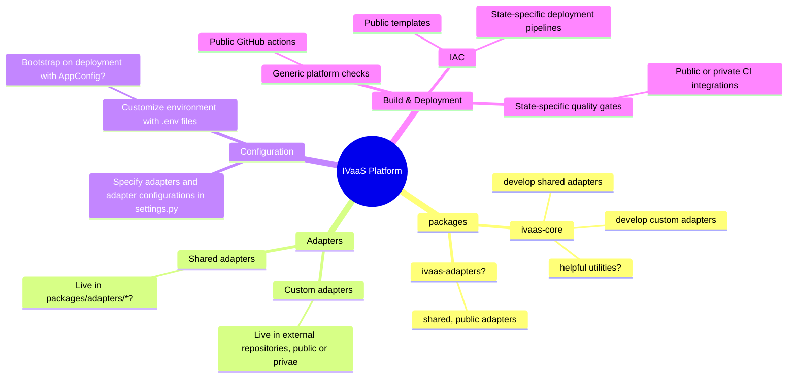

# Income Verification as a Service (IVaaS) Application

 |  | 

This is IVaaS, a customizable platform for income verification. It is designed for direct use by government entities, with no need to fork. By combining this codebase with a your own configuration files, the application can run on your preferred infrastructure.

Income data sources are selected via configuration, allowing you to connect to the specific set of sources used by your jurisdiction. Data source adapters with multi-state reusability are distributed along with the codebase, and custom adapters for local sources can be loaded during deployment.

The MVP will contain adapters for:
- Equifax - The Work Number (API v4)
- Digital Public Works - Verify My Income

Pull requests for additional data source adapters are welcome.

## Configuration

For documentation related to configuring IVaaS, see [ivaas-configuration](docs/configuration/ivaas-configuration.md).

## Development

For local development, see [ivaas-development](docs/development/ivaas-development.md) documentation.

## Structure

The (work-in-progress) intended structure of the ivaas platform based on its responsibilities and design requirements is as follows:

> [!NOTE]
> Areas of uncertainty marked with `?`

