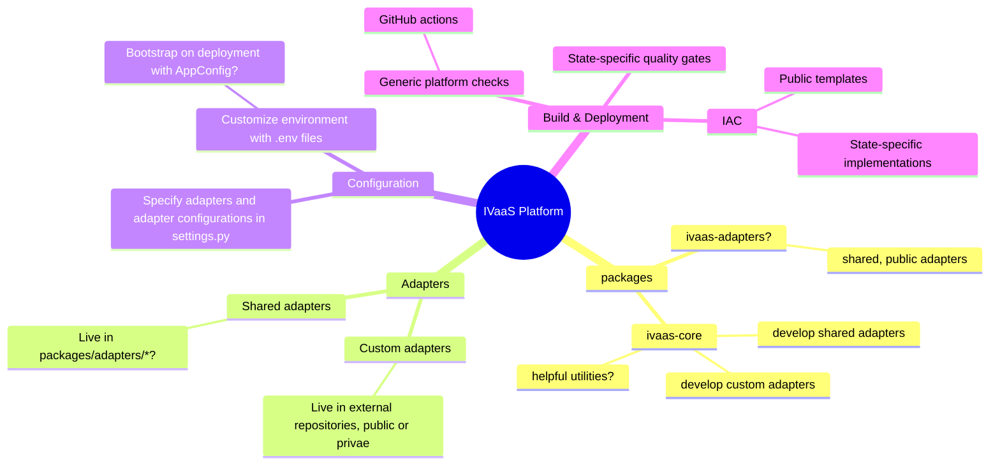

# Income Verification as a Service (IVaaS) Application

The application for IVaaS, a platform for standing up a customizable income verification service.

## Structure

The (work-in-progress) intended structure of the ivaas platform based on its responsibilities and design requirements is as follows:

> [!NOTE]
> Areas of uncertainty marked with `?`

## Development

For local development, see [ivaas-development](docs/development/ivaas-development.md) documentation.

## Configuration

For documentation related to configuring ivaas, see [ivaas-configuration](docs/configuration/ivaas-configuration.md).
