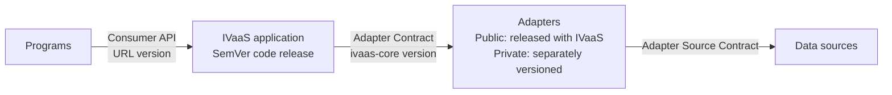
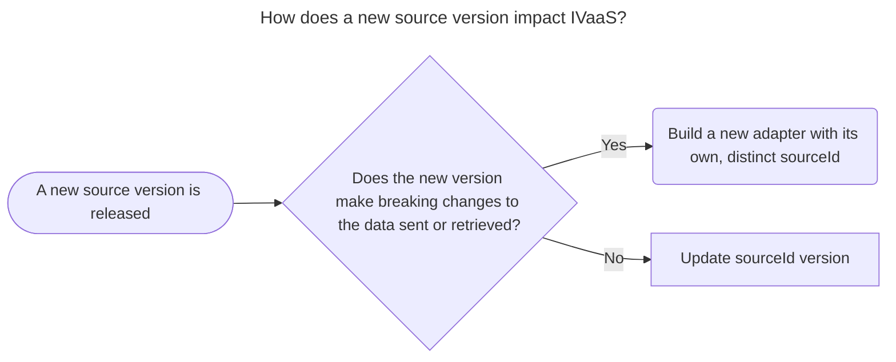

# API Management Strategy

IVaaS manages three contracts that can evolve independently:

1. **Consumer API Contract** — the client-facing HTTP API used by integrated partners, typically benefits programs.
2. **Adapter Contract** — the `ivaas-core` interface implemented by data source adapters.
3. **Adapter Source Contract** — the source-specific interface between an adapter and its data source.

IVaaS is designed so that implementations can be configured and deployed to infrastructure wherever it is needed. Deployers and maintainers of an IVaaS implementation must manage each contract to ensure compatibility at each layer of their implementation, as well as stability for their API clients.



A source's version, an adapter's version, the IVaaS code version, and the Consumer API version are independent. For example, migrating an adapter to a provider's `v2` API does not imply an adapter `2.x`, IVaaS `2.x`, or `/api/v2`.

For change management, see [Consumer API](#change-management), [Adapters](#change-management-1), or [Data Sources](#change-management-2).

> [!NOTE]
> While IVaaS is in pre-release development, its Consumer API, Adapter Contract, and adapter implementations should be treated as unstable. Breaking changes may be made directly as those contracts evolve, without preserving backward compatibility or introducing parallel versions. The compatibility, versioning, migration, and deprecation practices in this document apply once IVaaS begins supporting stable contract versions.

Compatibility should be verified at the contract boundary affected by a change.

## Consumer API

### Contract

The Consumer API is the IVaaS-owned HTTP contract used by programs. IVaaS maintains compatibility within each supported URL version:

```text
/api/v1/...
```

#### Source-Specific Data

IVaaS owns the `SourceResult` envelope defined in the [OpenAPI specification](open-api-spec.yaml), but `rawIncome` is consumer-visible, source-specific data produced by an adapter. Its structure may differ between sources and is not independently versioned by the Consumer API URL.

Programs should:

- Use `sourceId` to identify the source when interpreting `rawIncome`.
- Each adapter is responsible for defining the `rawIncome` response structure and integrity. Programs leveraging data from a source adapter's `rawIncome` property must treat each adapter's specification as supplemental to the Consumer API specification.
- Not assume that different sources return the same `rawIncome` structure.

If IVaaS later introduces a normalized income representation, that representation becomes part of the IVaaS-owned Consumer API contract and follows the Consumer API compatibility rules.

### Change Management

If an IVaaS-owned change requires existing programs to change, introduce a new URL version and provide a migration period where practical.

Examples of breaking changes include:

- Removing or renaming an endpoint or IVaaS-defined field.
- Changing an IVaaS-defined field's type or meaning.
- Making an optional request field required.
- Changing documented behavior on which programs rely.

Examples of generally non-breaking changes include:

- Adding an endpoint.
- Adding an optional request field.
- Adding an optional response field when programs are expected to tolerate additional fields.
- Adding a data source without otherwise changing the Consumer API contract.
- Fixing behavior to match the documented contract.

Multiple Consumer API versions may be supported concurrently while programs migrate.

An incompatible change to an adapter's `rawIncome` does not require a new Consumer API URL version. However, because programs may depend on source-specific fields or semantics, such changes require consumer impact assessment and an appropriate compatibility or migration path. Similar to a version Consumer API URL version, an individual adapter can be versioned through its `sourceId`.

Classify proposed Consumer API changes as compatible or incompatible with the current URL version.

For compatible changes, update the implementation and release IVaaS without changing the Consumer API version.

For incompatible changes:

1. Introduce a new Consumer API URL version.
2. Preserve the previous version during the migration period where practical.
3. Document the differences and required program changes.
4. Notify affected programs of the migration and planned retirement.
5. Retire the previous version after the migration period.

A Consumer API version change does not require the IVaaS SemVer major version to match the API version number.

#### Deprecation and Retirement

Consumer API versions follow this lifecycle:

```text
Active -> Deprecated -> Retired
```

When a Consumer API version is deprecated:

- Direct new integrations to its replacement.
- Document required migration changes.
- Notify known programs using the deprecated version.
- Communicate a retirement date when practical.

Retire the version after the migration period and a reasonable opportunity for known programs to migrate.

#### Compatibility Verification

Maintain automated tests for the Consumer API and validate the generated OpenAPI specification. CI should detect unintended incompatible contract changes where practical.

## Adapters

### Contract

`ivaas-core` defines the contract between the IVaaS application and data source adapters. It contains the shared adapter interface, request and result types, and source exception types used by both sides.

The IVaaS application depends on the `ivaas-core` package included in the IVaaS repository. Adapters also depend on `ivaas-core`; they do not depend on the IVaaS application itself.

This allows adapters to be developed and tested against the same contract the application provides at runtime while keeping adapter implementations independent from application internals.

Adapters translate between their sources and the `ivaas-core` contract. Cross-source orchestration belongs to IVaaS rather than individual adapters. The IVaaS engine orchestrates source selection, fallbacks, and applies retry and circuit-breaker policies configured for each adapter.

The Adapter Contract is independent of the Consumer API Contract. A change to `ivaas-core` requires a new Consumer API version only when it also changes the Consumer API incompatibly.

The `ivaas-core` package version identifies the Adapter Contract for compatibility purposes; it does not create a separate deployment lifecycle from IVaaS.

Each version of IVaaS includes `ivaas-core` and public adapters that evolve in tandem. Private adapters must be kept up-to-date with by their maintainers.

Ultimately, deployers and maintainers are responsible for ensuring that each deployment uses adapters compatible with the version IVaaS and `ivaas-core` they are installed into.

### Change Management

#### IVaaS Releases

IVaaS code releases are tagged using SemVer (`MAJOR.MINOR.PATCH`). The IVaaS code version identifies a revision of the deployable software and is independent of the Consumer API URL version.

An IVaaS release contains:

- The IVaaS application.
- The `ivaas-core` Adapter Contract used by that application.
- Public adapters maintained in the IVaaS repository.

A new IVaaS release does not imply a new Consumer API version. For example, IVaaS `2.x` may continue to expose `/api/v1` if the Consumer API remains compatible.

Release notes should identify deployer-impacting changes such as configuration changes, upgrade requirements, and adapter compatibility considerations.

#### Adapter Contract Changes

Changes to `ivaas-core` are evaluated independently from Consumer API changes.

For a backward-compatible Adapter Contract change, IVaaS may release the new `ivaas-core` contract while existing compatible adapters continue to run.

For a breaking Adapter Contract change:

1. Document the contract change and its compatibility requirements for private adapter maintainers.
2. Update and test affected public adapters as part of the IVaaS release.
3. Before upgrading a deployment, update and release any affected private adapters and test the resulting IVaaS and adapter combination.
4. Deploy only combinations verified to be compatible.

Public adapters migrate with the IVaaS release because they are maintained in the same repository. The IVaaS release can be published before private adapters are updated. Each deployer is responsible for identifying affected private adapters and verifying them before upgrading.

If IVaaS and required private adapters cannot be upgraded together, either:

- Temporarily preserve the previous Adapter Contract while adapters migrate; or
- Hold deployment of the IVaaS release until compatible adapter releases are available.

The previous Adapter Contract does not need to be supported indefinitely. Once required adapters and supported deployments have migrated, compatibility code for the old contract may be removed.

A breaking `ivaas-core` change does not require a new Consumer API version unless the Consumer API also changes incompatibly.

#### Adapter Contract Compatibility

Each IVaaS release provides a `ivaas-core` version. All adapters in a deployment must be compatible with that version. New IVaaS releases do not need to retain previous Adapter Contract versions.

Public adapters are migrated with each IVaaS release introducing the new contract.

Maintain contract tests for `ivaas-core` and tests demonstrating that the IVaaS application can load and invoke conforming adapters.

#### Public Adapters

Adapters intended for general IVaaS use are maintained in the IVaaS repository and follow the IVaaS release lifecycle.

Because these adapters are released with IVaaS, changes to `ivaas-core` and affected public adapters are developed and tested together. An IVaaS release must not include a public adapter that is incompatible with the `ivaas-core` contract in that release.

A change to a public adapter does not independently determine the IVaaS or Consumer API major version. The versioning impact depends on the contract affected by the change.

Public adapters should be tested against the `ivaas-core` contract as part of IVaaS CI.

#### Private Adapters

An organization deploying IVaaS may require adapters that cannot be maintained in the public IVaaS repository. Such adapters must be maintained in separate repositories and follow their own release lifecycle.

Private adapters are installed alongside IVaaS rather than becoming source or locked dependencies of the generic IVaaS repository.

Details for adapter configuration and installation [can be found in the configuration document](../configuration/ivaas-configuration.md#adapters).

Each private adapter:

- Implements the `ivaas-core` Adapter Contract.
- Declares its dependency on `ivaas-core`.
- Is independently built, tested, versioned, and released.
- Is installed only in deployments that require it.

Private adapter versions are independent of IVaaS and Consumer API versions. Deployers using private adapters will need to ensure continued compatibility with their IVaaS implementation.

#### Deployment Compatibility

An IVaaS deployment consists of:

```text
IVaaS release
├── IVaaS application
├── ivaas-core
├── public adapters
└── deployment configuration

+ zero or more private adapter releases
```

The IVaaS release determines the `ivaas-core` contract available at runtime. All adapters included in the deployment must be compatible with that contract.

Private adapter wheels are side-loaded into the deployment after the generic IVaaS dependencies are installed. An IVaaS installation with no private adapters is valid.

The deployment or integration pipeline is responsible for testing the actual combination being deployed. For configured private adapters, verification should confirm that:

- The adapter installs successfully with the IVaaS environment.
- Package dependencies are consistent.
- The adapter can be loaded and registered.
- The adapter satisfies the expected `ivaas-core` contract.
- Integration tests pass with the adapter enabled.

Private adapters must declare the `ivaas-core` version range they support.

Package dependency resolution alone is not sufficient to establish adapter compatibility. A package may satisfy its declared `ivaas-core` dependency while still violating the interface or runtime behavior expected by IVaaS.

Do not deploy an IVaaS/private-adapter combination that has not passed compatibility verification.

Private adapter repositories should test their adapters against the `ivaas-core` versions they declare as supported. The deployment or integration pipeline must additionally test the actual IVaaS/private-adapter combination before deployment.

## Data Sources

### Contract

An Adapter Source Contract is the interface between an adapter and the data source it integrates with. Depending on the source, this may be:

- A versioned API.
- An unversioned API.
- Database or data-share objects.
- Files or messages.
- Another source-specific integration mechanism.

IVaaS does not assume that a source exposes an explicit version identifier. Source changes are therefore managed according to compatibility and impact rather than provider-defined version numbers alone.

A source-defined version is also independent of IVaaS versioning, but can be tracked via the adapter's `sourceId` property. Moving to a new provider version does not by itself require a new IVaaS or adapter major version. Instead, the downstream impact should be assessed based on the source changes, and a suitable adapter change plan should be implemented.



### Change Management

#### Adapter Source Contract Changes

When a source changes, first determine whether the adapter can absorb the change while continuing to satisfy:

1. The `ivaas-core` Adapter Contract.
2. Its existing consumer-visible `rawIncome` behavior.

If both can be preserved, update and release the adapter without changing the Consumer API version.

For a public adapter, the change is released through the normal IVaaS release process. For a private adapter, release a new adapter package and update deployments to the tested release.

Changes such as source authentication, endpoints, query structure, or field mappings may therefore remain entirely within an adapter when they do not alter either contract above.

If the source change cannot be contained:

- If satisfying the source requires changing `ivaas-core`, follow the **Adapter Contract Changes** process.
- If a breaking change to `rawIncome` is unavoidable, identify affected programs and provide a compatibility or migration path.
- If the IVaaS-owned Consumer API requires a breaking change, introduce a new Consumer API URL version.

For a consumer-visible source change, determine:

1. Which programs are known to depend on the affected source data; if field-level use is unknown, treat all consumers of that source as potentially affected.
2. Whether the adapter can translate the new source representation into the previous representation.
3. Whether old and new behavior can coexist during a migration period.
4. How affected or potentially affected programs will be notified by their deployer.
5. What compatibility or migration mechanism is appropriate.

Source-specific versioning may be introduced when necessary, but IVaaS does not require every source to expose or map to a versioned contract.

#### Unannounced Source Changes

A source may make an incompatible change before IVaaS can update its adapter. Adapters should validate source responses where practical, but semantic changes cannot always be detected through schema validation.

When an adapter detects an invalid source response, it should surface an adapter error rather than a successful result.

Treat an unannounced incompatible source change as an integration incident. Identify the affected source, contain the failure, and update the adapter to restore its existing behavior where possible.

If restoring service requires a consumer-visible change, follow the same compatibility and migration process used for a planned Adapter Source Contract change.

#### Deprecation and Retirement

Data sources follow this lifecycle:

```text
Active -> Deprecated -> Retired
```

When a source is deprecated:

1. Identify programs using the source.
2. Identify replacement sources, if any.
3. Document consumer-visible behavior changes.
4. Determine required program or deployment migration work.
5. Communicate the expected retirement date.
6. Remove the adapter from IVaaS after the retirement date.

Retiring a source does not itself require a new Consumer API version. A new Consumer API version is required only if source retirement also requires an incompatible change to the IVaaS-owned Consumer API contract.

Retiring a source may require removing or disabling its adapter. For a public adapter, removal occurs through an IVaaS release. For a private adapter, the deployer removes the adapter from its deployment when the source is retired.

#### Compatibility Verification

Where practical, run automated end-to-end tests in non-production environments to detect compatibility issues across IVaaS, adapters, and data sources.

Adapters should validate and test the source behavior on which they depend, including response parsing and sanitization.

Where practical, integration tests should detect incompatible source response changes. Automated validation cannot detect every semantic source change, so source documentation, provider notices, monitoring, and reported integration failures remain part of source contract management.
