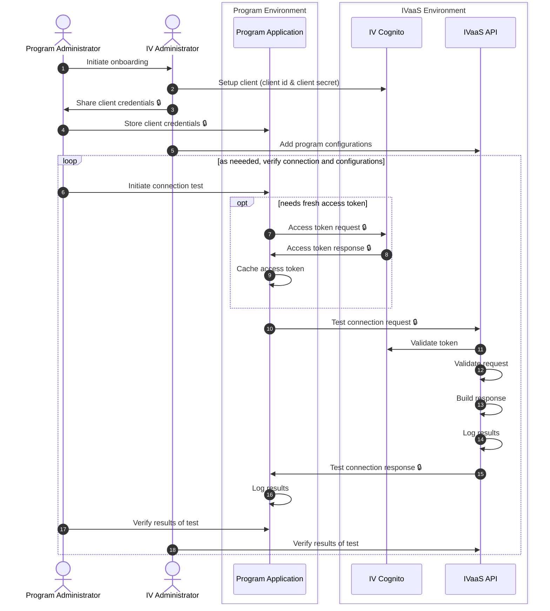
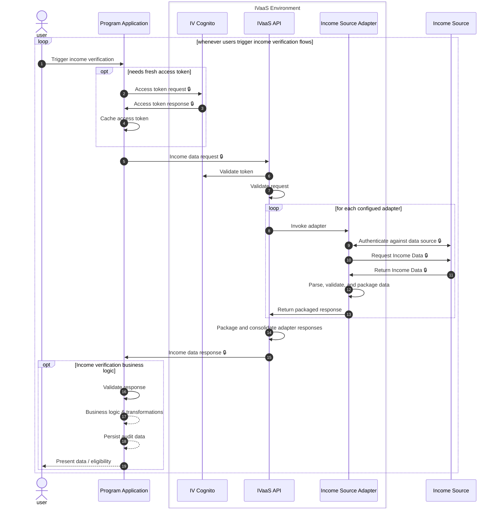

# Data Flow

> [!NOTE]
> Currently, this only shows the "happy path".
>
> Error cases can be added with `option` and/or `break`, but will significantly impact readability at ths stage.

API request details can be found in the [open-api-spec.yaml](./open-api-spec.yaml)

## Program Client Onboarding

## Income Verification API

