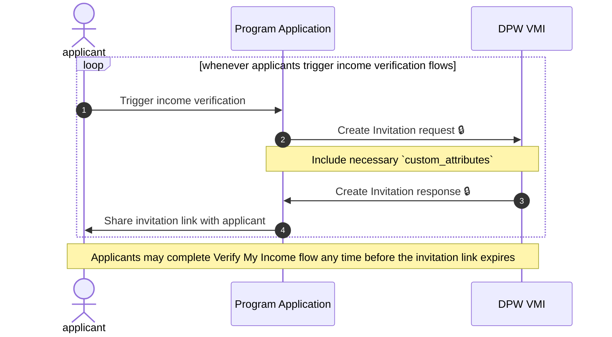
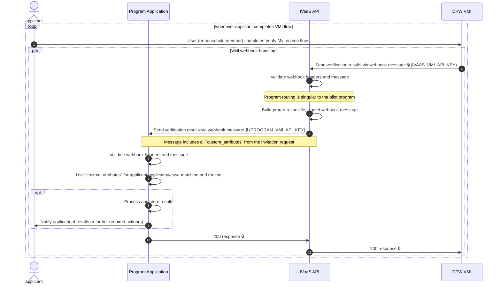
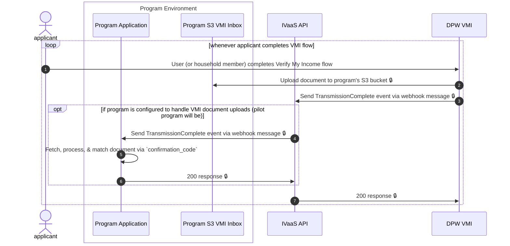
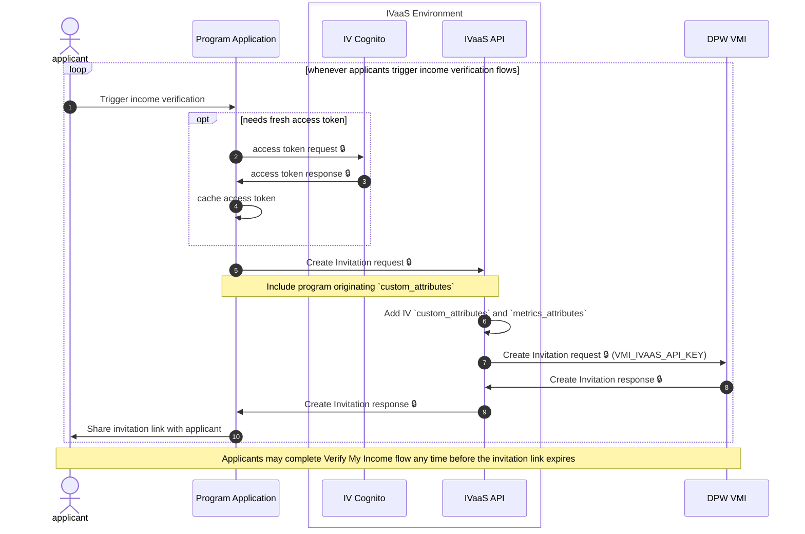
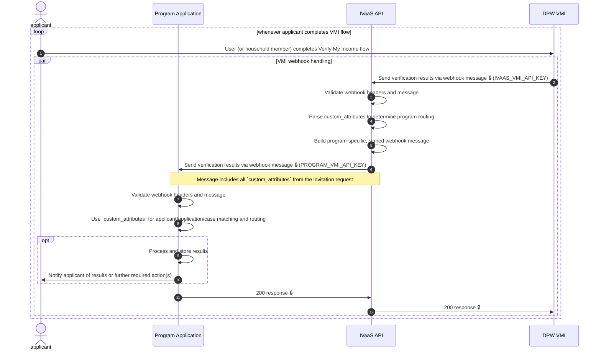
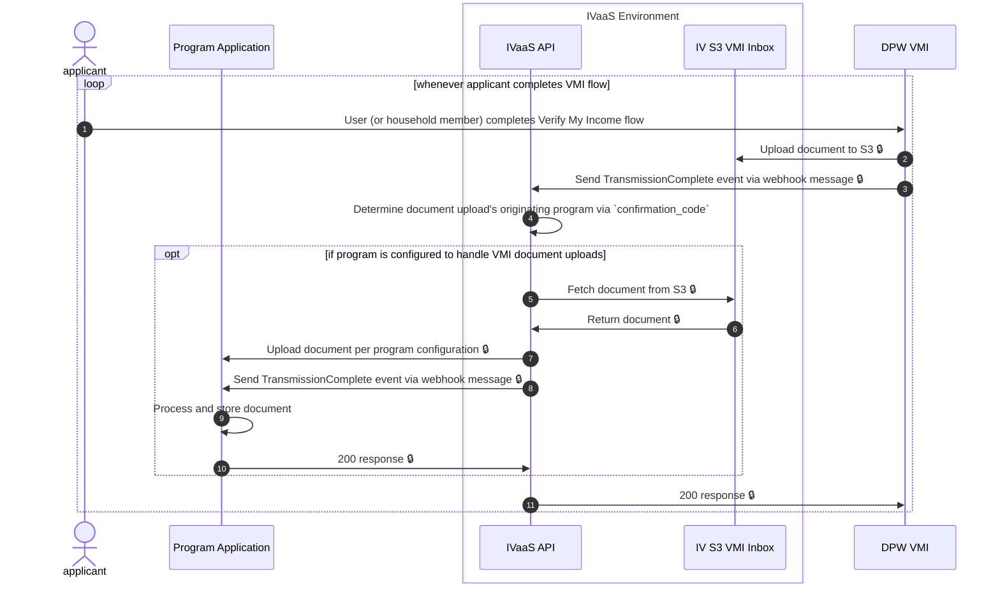

# Digital Public Works (DPW) - Verify My Income (VMI) Adapter Data Flow

Based on DPW's [Webhooks Transmission Spec](https://github.com/Digital-Public-Works/dicit-webhook-api-ref-impl/blob/main/Webhooks%20Data%20Transmission%20Spec%20v1.md)

## Program Client Onboarding

Programs must coordinate the configuration and implementation of several interactions with IVaaS:

1. The ability to generate VMI invite links for their users
   - This synchronous API call leverages the same API authentication as other IVaaS endpoints, so programs must register as clients as shown in the general IVaaS [data flow documentation](../../../../../docs/api/data-flow.md)
2. The ability to receive VMI verification results via webhook
   - Programs must expose an endpoint that IVaaS will POST VMI results to, and share an API key with the IVaaS team
3. (Optional) The ability to receive VMI verification results via document upload
   - If using, programs must configure IVaaS access to upload VMI verification documents

## Data Flow (Pilot)

During the initial pilot phase, the pilot program will use a direct integration to DPW's VMI for creating invitations.
Webhook events will route through IVaaS.

### Invite generation

### ReportSubmission Webhook

### Document results and TransmissionComplete webhook

## Data Flow

> [!NOTE]
> Currently, these diagrams only show the "happy path".
>
> Error cases can be added with `option` and/or `break`, but will significantly impact readability at this stage.

### Invite generation

### ReportSubmission Webhook

### Document results and TransmissionComplete webhook

